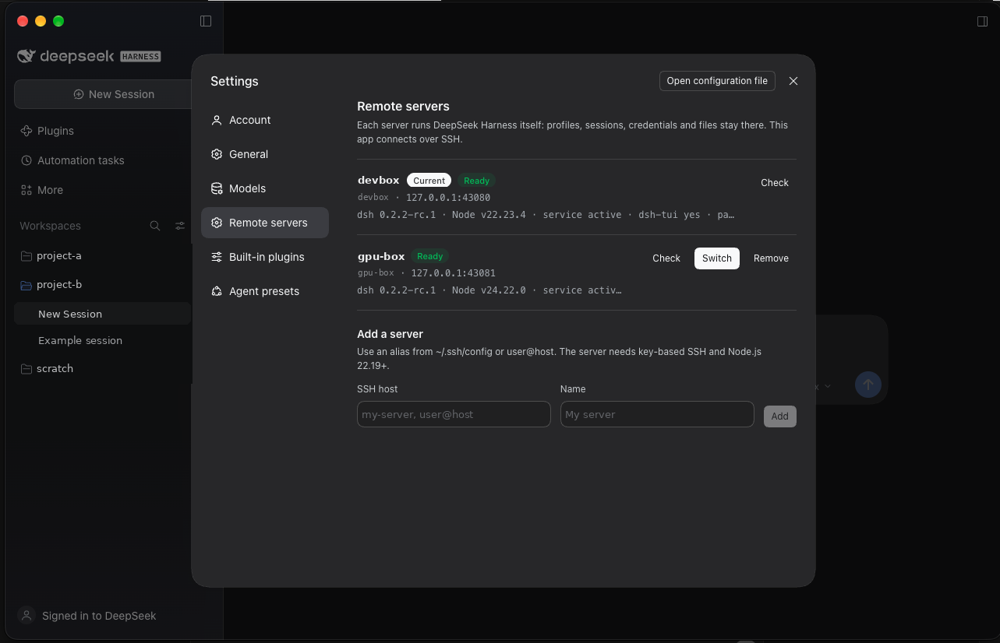

# DeepSeek Harness Remote

English | [中文](README.zh.md)

Run [DeepSeek Harness](https://github.com/deepseek-ai/deepseek-harness) on a server and use it from a Mac desktop app over SSH. It works the way Codex Desktop, Orca or VS Code Remote do: profiles, sessions, credentials, agents and files stay on the server, and the Mac only connects.



- **Desktop app, not a browser tab.** It keeps the official window, inset traffic lights, sidebar vibrancy and native shortcuts. The Web UI renders its Desktop layout.
- **Many servers, one window.** Add servers in **Settings → Remote servers**, then switch with one click or Cmd+Alt+1…9.
- **One-click server setup.** **Set up server** installs only what is missing over SSH: `dsh`, the `dsh-tui` terminal UI, pnpm, a `server` profile and a systemd user service.
- **SSH only.** The service listens on `127.0.0.1`, and the app reaches it through `ssh -L`. Nothing is exposed to the network, and no relay is involved.
- **DeepSeek account sign-in works.** The page is served over loopback, which is the only callback origin the account plugin accepts.

This addresses the requests in [#12670](https://github.com/deepseek-ai/deepseek-harness/discussions/12670), [#9529](https://github.com/deepseek-ai/deepseek-harness/discussions/9529) and [#12110](https://github.com/deepseek-ai/deepseek-harness/discussions/12110). It is a community project, not affiliated with DeepSeek.

## How it works

```
Mac: DeepSeek Harness Remote.app ──127.0.0.1:43080 ─ ssh -L <private socket> ─▶ server: dsh --profile server (127.0.0.1:3080)
                                 ──127.0.0.1:43081 ─ ssh -L <private socket> ─▶ second server …
```

1. The app reads `remote.json`, picks the active server, and over SSH starts its `dsh-server.service` if needed. It then reads the newest `dsh web: http://…/?token=…` line from the server log. A log another user could read or replace is refused.
2. The app holds `127.0.0.1:<localPort>` itself for as long as it runs, and passes connections on to `ssh -N -L <socket>:<listener>`, whose socket sits in a private (0700) directory. No other program can take the port while the app runs.
3. Each SSH connection reports which server it reached (the host key ssh verified, and the endpoint). Each server gets its own persistent browser session, named after that identity: cookies ignore ports, so the session is what keeps one server's login away from another. If an SSH alias or a host entry is pointed at a different machine, it opens in a new, empty session. Removing a server clears every session it used.
4. It loads `http://127.0.0.1:<localPort>/?token=…`. The server exchanges the token for a session cookie and serves its own Web UI.
5. If the tunnel drops, the app reconnects after 3 s, then 6 s, 12 s … up to every 60 s. Cmd+Shift+R reconnects at once.

The Remote servers page can list the configured servers and run the read-only check on them over your SSH keys. Adding, switching, removing and setting up a server each need a confirmation in a native dialog, which the page cannot answer.

The repository has two parts:

| Part | What it is |
|---|---|
| `app/` | The Electron client: tunnel, window, preload bridges, server switching. `build-mac.sh` turns it into `DeepSeek Harness Remote.app`. |
| `plugin/` | `dsh-remote-servers`, a DSH bundle that adds the **Remote servers** settings page. It installs on each server with `dsh plugin --profile server add`, and **Set up server** installs it for you. |

## Requirements

- **Mac:** macOS on Apple Silicon or Intel, Node.js (for `npx` during the build), and the official `DeepSeek Harness.app` installed once as the build source. You can uninstall it afterwards; see [Build](#build).
- **Server:** Linux with systemd, Node.js 22.19+, and key-based SSH from the Mac with no password prompt.

## Build

```sh
git clone https://github.com/bayhnf/dsh-remote-client && cd dsh-remote-client
(cd plugin && npm i --no-save esbuild && node build.mjs)   # builds the settings page bundle
./build-mac.sh                                               # -> ~/Applications/DeepSeek Harness Remote.app
```

`build-mac.sh` copies the official app and changes only the copy:

- It keeps DeepSeek's signed Electron runtime and icon, and removes the bundled local Host (`runtime/`, `app.asar.unpacked/`, auto-update).
- It packs `app/` as `app.asar` and uses its own bundle id (override it with `DSH_REMOTE_BUNDLE_ID`), so it runs beside the official app with separate storage.
- It signs the result ad hoc, so the build runs on the Mac that built it.

To uninstall the official app but keep building, save a copy first:

```sh
mkdir -p ~/dsh-remote-work
ditto -c -k --keepParent "/Applications/DeepSeek Harness.app" ~/dsh-remote-work/DeepSeek-Harness-<version>.app.zip
```

`build-mac.sh` uses the newest such zip when `/Applications/DeepSeek Harness.app` is absent, and keeps the previous app until the new build is complete. Rebuild after a new official release to pick up its Electron runtime; the Web UI itself comes from each server, so update DSH on the server to update the UI.

## First run

1. Add your server to `~/.ssh/config`. The app starts with one placeholder entry named `dsh-server`:

   ```
   Host dsh-server
     HostName your.server.example
     User you
   ```

2. Open **DeepSeek Harness Remote**. If the server is not set up yet, the window shows a connection error: choose **Connection → Set up this server…** in the menu bar. It works before any server UI is available.
3. Once connected, add more servers in **Account menu → Settings → Remote servers**. Use **From ~/.ssh/config** to pick an alias, or type `user@host`. To add a server before any server is set up, edit the settings file (**Connection → Open settings file**).

Adding, removing, switching and setting up servers each ask for confirmation in a native macOS dialog, so a page served by one server cannot act on your other servers.

| Action | Effect |
|---|---|
| Check | Reports Node, dsh, dsh-tui, the service state, and whether the running server has the Web UI and this page enabled (read from `dsh --profile server --dump-config`) |
| Set up server | Installs only what is missing (pinned: `@deepseek-ai/dsh@0.2.2-rc.1`, `@deepseek-harness-tui/dsh-tui@0.19.0`, `pnpm@10.33.0`); never upgrades an installed dsh or replaces an existing service, and restarts the service only when its profile changed since it started. The service log holds the launch token: it must sit in a directory only you can change (the default, `~/.dsh/logs`, is made 0700), and is kept 0600 |
| Switch | Closes the current tunnel and opens the chosen server in a new window, in that server's own session |
| Remove | Removes the entry and clears every browser session it used, on this Mac only; nothing on the server is deleted |

Settings live in `~/Library/Application Support/DeepSeek Harness Remote/remote.json` (and `sessions.json` remembers which session each server last used). Every value is validated before it reaches the `ssh` command line or the remote shell, and the page can only refer to servers by id.

## Terminal and other clients

The server is a normal DSH install, so other clients use the same data. `dsh-tui` (installed by **Set up server**) works over SSH, and editors such as Orca detect it as **DeepSeek Harness**.

## Development

```sh
npm install && npm test        # scripts on fake servers, transport, the main-process lifecycle, and the settings page in React
node vendor/build-desktop-keyboard.mjs <deepseek-harness checkout>   # refresh the bundled keyboard bridge
```

## Known limitations

- These bridges need the official app's local Host and are not provided: file save and drag-out to the Mac, the embedded usage/top-up page, update channels, and the native folder picker. The Web UI uses its own equivalents, including a directory browser for the server's folders.
- macOS only. The Electron client is cross-platform, but there is no Windows or Linux packaging script yet.
- The build is signed ad hoc. Distributing it to other Macs needs a Developer ID signature.

## License

MIT. Parts are ported from or bundle DeepSeek Harness (MIT); see [THIRD_PARTY_NOTICES.md](THIRD_PARTY_NOTICES.md).
