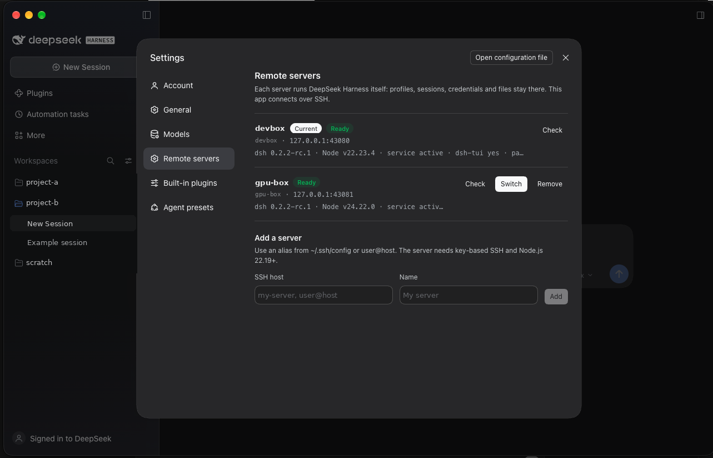

# DeepSeek Harness Remote

[English](README.md) | 中文

在服务器上运行 [DeepSeek Harness](https://github.com/deepseek-ai/deepseek-harness)，在 Mac 桌面应用里通过 SSH 使用它，用法类似 Codex Desktop、Orca 或 VS Code Remote：配置、会话、凭据、Agent 和文件都留在服务器上，Mac 只负责连接。



- **桌面应用，而不是浏览器标签页**：保留官方窗口、内嵌红绿灯、侧栏毛玻璃和原生快捷键，Web UI 以桌面布局渲染。
- **多台服务器，一个窗口**：在 **设置 → 远程服务器** 中添加服务器，一键切换，或使用 Cmd+Alt+1…9。
- **一键配置服务器**：**配置服务器** 通过 SSH 只安装缺少的部分：`dsh`、终端界面 `dsh-tui`、pnpm、`server` 配置和 systemd 用户服务。
- **只走 SSH**：服务只监听 `127.0.0.1`，应用通过 `ssh -L` 访问，不对网络暴露，也不经过任何中转。
- **DeepSeek 账号登录可用**：页面经由回环地址提供，这是账号插件唯一接受的回调来源。

本项目对应 [#12670](https://github.com/deepseek-ai/deepseek-harness/discussions/12670)、[#9529](https://github.com/deepseek-ai/deepseek-harness/discussions/9529)、[#12110](https://github.com/deepseek-ai/deepseek-harness/discussions/12110) 中的需求。这是社区项目，与 DeepSeek 无关。

## 工作原理

1. 应用读取 `remote.json`，选中当前服务器，通过 SSH 在需要时启动其 `dsh-server.service`，并从服务器日志读取最新的 `dsh web: http://…/?token=…` 行。其他用户可读取或替换的日志会被拒绝。
2. 应用在运行期间自行占用 `127.0.0.1:<本地端口>`，并把连接转交给 `ssh -N -L <套接字>:<监听地址>`，该套接字位于私有（0700）目录中。应用运行时其他程序无法占用该端口。
3. 每个 SSH 连接都会报告它到达的服务器：最终目标的用户、地址和端口，以及 ssh 为其验证的主机密钥（ProxyJump 跳板主机不计入）。每台服务器使用以此身份命名的独立持久化浏览器会话：Cookie 不区分端口，因此由会话隔离。若 SSH 别名或服务器条目指向了另一台机器，会在新的空会话中打开。移除服务器时会清除它用过的所有会话。
4. 加载 `http://127.0.0.1:<本地端口>/?token=…`，服务器用令牌换取会话 Cookie，并提供自身的 Web UI。
5. 隧道断开后先在 3 秒后重连，之后 6 秒、12 秒……最长每 60 秒一次；Cmd+Shift+R 立即重连。

远程服务器页面可以列出已配置的服务器，并通过你的 SSH 密钥对其执行只读检查。添加、切换、移除和配置服务器都需要在原生对话框中确认，页面无法代为确认。

| 部分 | 说明 |
|---|---|
| `app/` | Electron 客户端：隧道、窗口、预加载桥接、服务器切换。`build-mac.sh` 将其打包为 `DeepSeek Harness Remote.app`。 |
| `plugin/` | `dsh-remote-servers`，添加 **远程服务器** 设置页的 DSH 包，用 `dsh plugin --profile server add` 安装到每台服务器；**配置服务器** 会自动安装。 |

## 要求

- **Mac**：macOS（Apple Silicon 或 Intel）、Node.js（构建时使用 `npx`），以及作为构建来源安装一次的官方 `DeepSeek Harness.app`（之后可以卸载，见下文）。
- **服务器**：带 systemd 的 Linux、Node.js 22.19+，以及从 Mac 免密码的密钥 SSH 登录。

## 构建

```sh
git clone https://github.com/bayhnf/dsh-remote-client && cd dsh-remote-client
(cd plugin && npm i --no-save esbuild && node build.mjs)
./build-mac.sh      # -> ~/Applications/DeepSeek Harness Remote.app
```

`build-mac.sh` 复制官方应用，只修改副本：保留 DeepSeek 签名的 Electron 运行时和图标，去掉内置的本地 Host 与自动更新，打包 `app/` 为 `app.asar`，使用独立的 Bundle ID（可用 `DSH_REMOTE_BUNDLE_ID` 覆盖），并进行临时签名。

若要卸载官方应用但继续构建，先保存一份副本：

```sh
mkdir -p ~/dsh-remote-work
ditto -c -k --keepParent "/Applications/DeepSeek Harness.app" ~/dsh-remote-work/DeepSeek-Harness-<版本>.app.zip
```

## 首次使用

1. 在 `~/.ssh/config` 中添加服务器。应用初始包含一个名为 `dsh-server` 的占位条目：

   ```
   Host dsh-server
     HostName your.server.example
     User you
   ```

2. 打开 **DeepSeek Harness Remote**。若服务器尚未配置，窗口会显示连接错误：在菜单栏选择 **Connection → Set up this server…**，此操作在服务器界面可用之前即可使用。
3. 连接后，在 **账户菜单 → 设置 → 远程服务器** 中添加更多服务器，可点击 **来自 ~/.ssh/config** 选择别名，或输入 `user@host`。在尚无可用服务器时添加服务器，请编辑设置文件（**Connection → Open settings file**）。

添加、移除、切换和配置服务器都需要在 macOS 原生对话框中确认，因此某台服务器提供的页面无法操作你的其他服务器。

设置保存在 `~/Library/Application Support/DeepSeek Harness Remote/remote.json`。所有值在进入 `ssh` 命令行或远程 shell 之前都会被校验，页面只能通过 id 引用服务器。

## 已知限制

- 依赖官方应用本地 Host 的能力不可用：保存或拖出文件到 Mac、内嵌的用量/充值页、更新通道、原生文件夹选择器。Web UI 会使用自己的替代方案，包括浏览服务器目录的选择器。
- 目前仅支持 macOS 打包。
- 构建为临时签名；分发到其他 Mac 需要 Developer ID 签名。

## 许可证

MIT。部分内容移植自或打包了 DeepSeek Harness（MIT），见 [THIRD_PARTY_NOTICES.md](THIRD_PARTY_NOTICES.md)。
